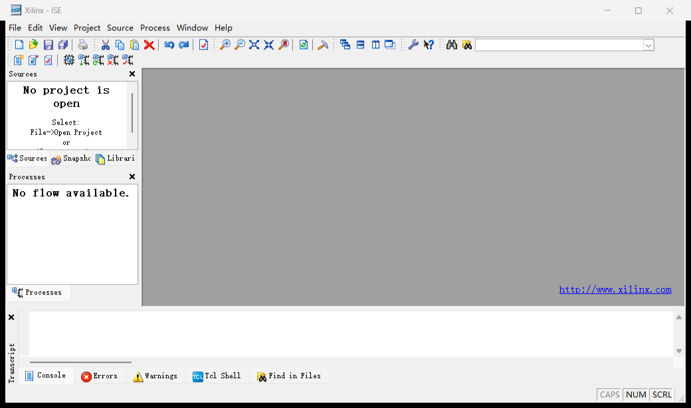

# 当 2007 年的 FPGA 工具遇上 2026 年的 Windows 11

### Xilinx ISE 9.2i "跑不起来" 的完整排查记录：一个被 WSL 意外绊倒的老程序

| | |
|---|---|
| **受影响** | Xilinx ISE 9.2i（2007，VC7.1 编译的 32 位程序），其他老版本 ISE 同理 |
| **现象** | `ise.exe` 在 Windows 10 1607 及更早能正常启动；在之后的 Win10 与所有 Win11 上**静默挂死**：不崩溃、不弹窗、无窗口、无子进程、CPU 空闲、进程永不退出 |
| **根因** | 新系统网络提供程序列表中新增的 **p9np.dll（Plan 9 Network Provider，WSL `\\wsl$` 文件共享）** 在 `NPEnumResource` 中永久阻塞；ISE 启动时经 MPR 枚举网络驱动器，被无限期卡住 |
| **修复** | 在 ISE 的 `bin\nt` 目录放一个 40 KB 的 `MPR.dll` 代理（利用加载器"应用目录优先"的搜索顺序），让枚举按"无网络盘"优雅失败。无需管理员、不动原文件、不影响 WSL |
| **验证** | 修复前 3 次启动全部挂起；修复后 `ise.exe` 秒起，弹出 `Xilinx - ISE` 主窗口与 `Tip of the Day`，含"无环境变量模拟双击"场景均通过 |
| **现象②** | GUI 能启动后，命令行工具（`createsch`/`sch2sym`/`asc2sch`…）全部报 `Environment variable 'TEMP' not defined or points at a non-existant directory...`，退出码 19，连版本 banner 都打不出来 |
| **根因②** | `libPortability.dll` 的临时目录"开机自检"在现代 Windows 的**工具进程初始化上下文**里对完全有效的目录误判（同一 DLL 运行时加载则自检通过；裸 Win32 文件 API 全部正常） |
| **修复②** | 特征码校验后的 **3 字节补丁**（`mov al,1; ret`）让自检放行 `%TEMP%`；原文件备份为 `libPortability.dll.orig`，可一键还原。见 [`tools/patch_libportability.ps1`](tools/patch_libportability.ps1) |

**TL;DR (English)**: Xilinx ISE 9.2i hangs silently on Windows 10 1903+ / Windows 11. Root cause: the WSL "Plan 9 Network Provider" (`p9np.dll`) deadlocks inside `NPEnumResource` when ISE enumerates mapped network drives via `WNetEnumResourceA` at startup; MPR calls providers sequentially with no timeout. Fix: drop a 40 KB proxy `MPR.dll` into ISE's `bin\nt` directory — the Windows loader prefers the application-directory copy over System32, the enumeration fails gracefully, and ISE starts. See [English TL;DR](#english-tldr) for details.

---

## 0. 问题与最初猜想

手头有一套 2007 年的 Xilinx ISE 9.2i（最后的 9.x 版本，Still supports Spartan-3/3E/3A、Virtex-4/5、XC9500 等老器件，至今仍是一些老开发板唯一顺手的工具）。实测它在 **Windows 10 1607 及更早**的系统上能正常启动，但在**之后的 Win10 版本和所有 Win11** 上"跑不起来"。

第一直觉非常合理：这种年代的程序是 32 位、无 ASLR、重定位被剥离、固定基址加载的——**是不是新系统新增功能的内存地址和它冲突了？**（比如某个新 DLL 抢了它的首选基址，导致 `0xC0000018 STATUS_CONFLICTING_ADDRESSES`。）

顺着这条线索，我们把整条链查了个底朝天。答案出乎意料：**地址没有冲突，冲突的是"新系统插进老代码必经之路上的一根管子"。**

## 1. 现场勘查：ise.exe 只是个 18 KB 的"点火器"

对 `bin\nt\ise.exe` 做 PE 头分析：

| 属性 | 值 |
|---|---|
| 编译器 / 链接时间 | VC7.1（VS2003 时代工具链），2007-10-19 |
| 位数 / 子系统 | x86 (32-bit) / GUI |
| DllCharacteristics | `0x0000`——**无 ASLR、无 DEP、无 CFG** |
| 重定位 | **被剥离**（`.reloc` 为空），必须加载在 ImageBase `0x400000` |
| 导入表 | 只有 `MSVCR71.dll` + `KERNEL32.dll`（`LoadLibraryA/GetProcAddress/GetModuleFileNameA/getenv...`） |

18 KB 的体积说明它只是个启动器：真正的 Project Navigator 引擎在旁边一大票 DLL 里（`libGui_Gq.dll` 1.5 MB、`libGui_Gfq.dll`、`libPortability.dll`、`libQt_Qt.dll`——Xilinx 魔改的 Qt 3 框架，`_pn.exe` 才是 250 KB 的主程序入口之一）。`libPortability.dll` 同样是 VC7.1、无 ASLR、重定位剥离。

到这里，"固定基址冲突"的嫌疑仍然成立，但 PE 是静态证据——**得让它跑起来看**。

## 2. 复现：不是崩溃，是"心电图拉平"

在 Windows 11 IoT LTSC 24H2（Build 26100）上启动 `ise.exe`，连续三次，结果完全一致：

- 进程活着，**永不退出**；
- **0 个可见窗口、0 个子进程**；
- CPU 占用 ≈ 0（不是死循环空转，是在"等"）；
- 应用程序事件日志无任何崩溃记录，WER 无报告，也没有任何弹窗。

这不是"加载失败"（没有 `0xC0000135` 缺 DLL、没有 `0xC0000018` 基址冲突、没有 `0xC0000005`），也排除了地址冲突假说最典型的症状。**它是挂起。**

> 排查小插曲：用 .NET 的 `Process.Start` 启动它时，外层脚本本身也会被莫名拖住；换用原生 `CreateProcessW` + `CREATE_DEFAULT_ERROR_MODE`（父进程 `SetErrorMode(SEM_FAILCRITICALERRORS|SEM_NOGPFAULTERRORBOX)`，继承给子进程）后，既能拿到干净的退出码，也不会在桌面上弹出任何硬错误对话框。

## 3. 自制探针：给 32 位老进程"抓心电图"

挂起没有错误码可看，那就直接看它卡在哪。写了一个小探针（见 [`tools/wow64_hang_probe.ps1`](tools/wow64_hang_probe.ps1)）：

1. 原生 `CreateProcessW` 启动目标；
2. 轮询进程树、`EnumWindows` 枚举窗口、采样 CPU 时间；
3. 用 `CreateToolhelp32Snapshot` 抓 32 位模块表（`TH32CS_SNAPMODULE|TH32CS_SNAPMODULE32`）；
4. 关键一步：对 WOW64 线程用 **`Wow64SuspendThread` + `Wow64GetThreadContext`** 拿到 x86 上下文，再 `ReadProcessMemory` 沿 EBP 链回溯返回地址，映射到"模块+偏移"。

挂起 44 秒时的主线程栈，元凶当场现形：

```text
tid 38224  eip=ntdll+0x7837C (等待)
  KERNELBASE+0x160032          ; WaitForSingleObjectEx
  p9np+0xD82F                  ; ← NPEnumResource！卡在这里
  MPR+0x44D6 / MPR+0x43CE      ; WNetEnumResourceW 内部
  MPR+0xEEFE                   ; WNetEnumResourceA
  libPortability+0x155AC       ; ISE 自己的"可移植层"
```

**p9np.dll —— "Plan 9 Network Provider"**，也就是 WSL 的 `\\wsl$` / `\\wsl.localhost` 文件共享网络提供程序。它是随 WSL 文件共享能力进入系统的（WSL2 时代，约 2019 年的 Windows 10 1903；具体引入版本可用 `reg query "HKLM\SYSTEM\CurrentControlSet\Services\Control\NetworkProvider\Order" /v ProviderOrder` 在各机器上自行核对）——**1607 的世界里根本没有它**。

## 4. 逻辑闭环：ISE 为什么要碰 WNet？

用 VS2008 的 `dumpbin /disasm` 反汇编 `libPortability.dll`，在 `0x155A7` 附近看到完整调用序列：

```asm
10015531: lea  ecx,[esp+24h]        ; &hEnum
10015535: push ecx
10015536: push 0                    ; dwUsage
10015538: push 0                    ; lpNetResource = NULL
1001553A: push 1                    ; dwType   = RESOURCETYPE_DISK
1001553C: push 1                    ; dwScope  = RESOURCE_CONNECTED
1001553E: call 1004DBF4             ; → WNetOpenEnumA
          ...                       ; 申请 0x640 字节缓冲
1001559F: mov  dword ptr [esp+24h],0FFFFFFFFh   ; count = -1
100155A7: call 1004DBEE             ; → WNetEnumResourceA(hEnum,&count,buf,&size)
100155AC: cmp  eax,0EAh             ; ERROR_MORE_DATA? → 扩缓冲重试
100155B5: jne  100155DB             ; 否则处理条目
          ...                       ; 比对 lpLocalName 盘符、lpRemoteName 是否 "\\" 开头
1001565E: call 1004DBE8             ; → WNetCloseEnum
```

也就是说：**ISE 一启动就会枚举"当前已连接的网络驱动器"**，把盘符映射到 UNC 路径（典型的老式路径规范化逻辑）。而 MPR 处理 `WNetEnumResource` 时要**顺序调用系统里注册的每一个网络提供程序**，没有任何超时。新系统比 1607 多注册了一个 p9np，它的 `NPEnumResource` 要去联系 WSL 的 9P 端点——在我们的机器上（WSL 正跑着内核实验）它永远等不到回应，于是整个枚举、乃至整个 ISE 启动流程，被无限期挂起。

`bin\nt` 里一共只有 3 个模块碰 WNet：`libPortability.dll` 与 `libGui_Framework.dll`（`WNetOpenEnumA / WNetEnumResourceA / WNetCloseEnum`）和 `libCoreu_Interface.dll`（`WNetGetUserA`）。全系统扫描也只出现这 4 个 WNet 函数名——影响面清清楚楚。

## 5. 修复：不改老程序，给它"递一张白名单外的牌"

两条路：

- **系统级**（需管理员）：把 `P9NP` 从 `HKLM\SYSTEM\CurrentControlSet\Services\Control\NetworkProvider\Order` 的 `ProviderOrder` 里摘掉。有效，但会影响 `\\wsl$` 访问，且要动注册表。
- **应用级**（推荐，最终采用）：Windows 加载器解析静态导入时，**"应用程序所在目录"优先于 System32**（`MPR.dll` 不在 KnownDLLs 列表里，已核实）。于是往 ISE 的 `bin\nt` 里放一个 40 KB 的同名 `MPR.dll` 代理：ISE 全家桶都会先加载它，它把网络枚举按"这台机器没有映射网络盘"优雅返回——这正是 ISE 在无网盘机器上的正常路径。

代理的行为（源码见 [`src/mpr_proxy.c`](src/mpr_proxy.c)）：

| 导出函数 | 返回 | 效果 |
|---|---|---|
| `WNetOpenEnumA/W` | `ERROR_NO_NETWORK` (1223) | 枚举直接打不开，ISE 跳过整个循环 |
| `WNetEnumResourceA/W` | `ERROR_NO_MORE_ITEMS` (259)，`*count=0` | 兜底安全 |
| `WNetCloseEnum` | `NO_ERROR` | 收尾无害 |
| `WNetGetUserA/W` | `ERROR_NOT_CONNECTED` (2250) | 等价于"没有网络连接"的正常失败 |

编译用 VS2008（`cl /nologo /W4 /O2 /MT /LD mpr_proxy.c /link /def:mpr_proxy.def /out:MPR.dll`），静态链接 CRT，产物只依赖 kernel32——和这套 2007 年的工具算得上同代工具链的隔空握手。

## 6. 验证

部署代理前后各跑若干次（Win11 24H2）：

- **修复前**：3 次启动全部静默挂死，44 秒后线程仍停在 `p9np!NPEnumResource`，0 窗口。
- **修复后**：3 秒内开始创建窗口，约 30 秒弹出 **`Xilinx - ISE` 主窗口**和经典的 **`Tip of the Day`** 对话框，119 个窗口稳定存在 60 秒以上；
- 再用**不带任何环境变量**的方式启动（模拟用户直接双击），同样正常——见 `screenshots/`。




## 7. 使用方法

1. 到 [Releases](../../releases) 下载 `MPR.dll`，放进 ISE 9.2i 安装目录的 `bin\nt\` 下（与 `ise.exe` 同目录）；
2. 再运行 [`tools/patch_libportability.ps1`](tools/patch_libportability.ps1) 修复工具进程的 TEMP 自检：
   `.\patch_libportability.ps1 -BinNt "C:\你的ISE安装目录\bin\nt"`；
3. 正常启动 `ise.exe`。不满意随时完全还原：删掉 `MPR.dll`，并对脚本加 `-Revert` 参数。

> 自己编译：安装 VS2008（或任何能出 32 位 x86 的 MSVC），运行 `build\build.bat`。

## 8. 复盘：三条通用经验

1. **"跑不起来"先分诊**：崩（有错误码/WER）、退（有退出码）、挂（无窗口无输出）是三种病。挂起没有错误码，抓栈是最短路径。
2. **WOW64 老进程抓栈**：`Wow64GetThreadContext` + EBP 链回溯 + Toolhelp 模块表，不装 WinDbg 也能十分钟定位到"卡在哪个系统组件"。
3. **老程序 + 新系统，未必是地址冲突**：更多时候是"新组件插进了老代码的必经之路"。这次是网络提供程序，别的地方可能是字体、GDI、打印、IMM——思路都是找出那条必经之路，然后给它一个"优雅降级"的出口。
4. **修复要选对"加载时机"**：同一份补丁逻辑，放进 MPR 代理的 DllMain 里对工具进程无效（MPR 在工具进程里加载得太晚甚至不加载），直接补在 `libPortability` 上才生效。代理适合"替换外部依赖的行为"，不适合"修它自己身上的代码"。
5. **"报 TEMP 的错，未必是 TEMP 的问题"**：老程序的自检逻辑会把一堆内部失败统一翻译成一条模糊的用户提示。把提示里的每个字面量（TEMP 目录）都换成合法值再做一轮实验，往往就能把"环境问题"和"代码问题"切开。

## 9. 第二幕：能启动了，"Creating Schematic" 却全体罢工

故事并没有在主窗口弹出的那一刻结束。真正开始建工程时，"Creating Schematic" 一步失败，输出里出现：

```text
Environment variable 'TEMP' not defined or points at a non-existant directory
or a non-writable directory. Please define it to a directory location for
temporary files.
```

进程退出码 19。`bin\nt` 下的命令行工具（`createsch` / `sch2sym` / `asc2sch`……）**全军覆没**，连版本 banner 都来不及打印。第一反应当然是：是不是排查过程污染了环境？逐项排除：

| 实验 | 结果 |
|---|---|
| 核对注册表 `HKCU\Environment` 的 TEMP/TMP | 从未被改动，目录存在可写 |
| TEMP 指向不存在目录 / 指向新建的 `C:\TEMP` / 删除 TEMP / 恢复原值 | 四种状态**全部**报同样的错 |
| 带上 `XILINX` + `PATH`（模拟 GUI 的启动环境） | 依旧失败 |
| **移除 MPR.dll 代理做 A/B** | **依旧失败（且不挂起）** |
| 不链接 CRT 的裸内核32程序里调 `GetFileAttributesExA` / `CreateFileA` 探针文件 | **全部成功** |

结论：与环境无关、与代理无关、甚至与 TEMP 的值无关——连硬编码候选 `C:\TEMP`、`C:\TMP` 都被拒。**报 TEMP 的错，不是 TEMP 的问题。**

## 10. 定位：libPortability 的"开机自检"

反汇编 `libPortability.dll`，找到打印这条消息的检查函数（`0x10012E77`）：它依次尝试 `getenv("TEMP")` → `getenv("TMP")` → `"C:\TEMP"` → `"C:\TMP"`，每个候选都交给校验器 `validate`（`0x10012820`）：长度 ≤ 260 → `GetFileAttributesExA` → 非 READONLY → `_stat` 确认是目录 → 最后在目录里构造 `%s\xil_%d_%d` 探针文件验证可写。任何一环失败，统一打印 TEMP 消息并 `exit(19)`。

最有意思的对照实验：写一个测试程序在**运行时** `LoadLibrary("libPortability.dll")`，它的初始化自检**能通过**；同一个 DLL 在 `createsch.exe` 里以**进程初始化（静态导入）**方式加载，自检**必失败**。同一份 DLL、同一个目录、同一台机器，差别只在加载时机与进程上下文——2007 年的自检逻辑在 2026 年的进程初始化序列里误判了。

（顺带排除一条路线：把内存补丁塞进 MPR 代理的 DllMain 里去修 `libPortability`。但工具进程里 MPR 加载得太晚甚至根本不加载——代理能救 GUI 的启动，救不了工具的初始化。）

## 11. 修复：3 个字节

`validate` 的唯一职责就是这次自检。把它的序言（14 字节特征 `64 A1 00 00 00 00 6A FF 68 A4 F6 04 10 50`，含 SEH 注册）原地改成 `mov al,1; ret`（`B0 01 C3`）——校验器恒真，工具直接使用 `%TEMP%`。原始文件先备份为 `libPortability.dll.orig`；脚本只在特征码**唯一命中**时才动刀，支持 `-Status` / `-Revert`，随时还原。见 [`tools/patch_libportability.ps1`](tools/patch_libportability.ps1)。

## 12. 第二幕验证

| 项 | 修复前 | 修复后 |
|---|---|---|
| `createsch` / `sch2sym` / `asc2sch` | exit 19 + TEMP 消息 | exit 0，正常打印版本与 Usage |
| `ise.exe` GUI | 正常 | 正常（无回归） |

## 13. 第三幕："打了补丁连工程都打不开了？"——先查时间线

补丁装上后用户反馈：所有 `.ise` 工程打不开、新建也一样，报 `ERROR:ProjectMgmt - A problem occurred while loading the project`。第一反应当然是自己闯祸了，于是做 A/B 取证：

| 证据 | 时间 | 说明 |
|---|---|---|
| `hello.restore` / `hello.ise_ISE_Backup`（打开失败的"还原点"产物） | **23:29:32** | 补丁 **23:42+** 才写入磁盘 |
| 补丁前用户会话 | ~23:29 | 工程打开失败（快失败 + 写还原点） |
| 补丁后用户会话 | ~23:47 | 工程打开仍然报错 |

结论：**工程打不开是第三个独立问题，先于补丁存在**；补丁既不是它的原因，也（尚未）成为它的解药。

对卡死现场（`_pn.exe`，挂起 100s+）的测量：

- 主线程栈：`win32u!NtUserGetMessage ← libQt_Qt（事件循环）← libPn_ProjectMgrPlugin+0xA6DB3/0xAC330`——主线程在**模态的 "Project Open" 进度对话框**里泵消息，等一个永远不来的异步完成信号；
- 150ms 高频轮询 25 秒：**零子进程**；
- `Get-NetTCPConnection`：**零网络连接**；
- CPU ≈ 0，工作线程（含两个 `libtcl84` 线程）全部空闲等待。

即：不是等子进程、不是等网络，是 ISE 工程管理插件内部的一条异步流水线根本没有产出结果。

**补丁方案的取舍（记录一次失败尝试）**：曾试过更"保守"的改法——不改 `validate` 本体，改检查函数的失败分支（`0x10012EF5`），把 `exit(19)` 改成跳到 `0x10012F0B` 的"注册临时目录"序列。实测：按自然序列 `push esi; call 10047590` 落点，进程在 DLL 初始化阶段直接 `0xC0000142`；跳过 `push` 落在 `call` 上虽能启动，但工具进程会用一个垃圾指针注册临时目录，语义劣化。最终保留 **validate 桩**（`mov al,1; ret`）：所有候选目录都直接通过，工具进程以真实的 `TEMP` 目录注册，语义最干净。

## 14. 现状清单（第三幕）

| 项 | 状态 |
|---|---|
| GUI 启动（MPR 代理） | ✅ |
| 工具启动（validate 桩） | ✅ `createsch` exit 0 + 正常 banner |
| 工程打开 / 新建 | ❌ 第三问题，未解决（已排除子进程 / 网络 / CPU 因素） |
| 备份与回退 | ✅ `libPortability.dll.orig` + `-Revert` 随时还原 |

第三问题的下一步：给 `libPn_ProjectMgrPlugin` 的完成路径下断点、找一台"健康"机器对比、或读出 "Project Open" 进度对话框当前卡住的步骤文本。

## English TL;DR

Xilinx ISE 9.2i (2007, 32-bit, VC7.1) starts fine up to Windows 10 1607 but hangs silently on later Win10 builds and all Windows 11: no window, no crash, no error code, near-zero CPU. We reproduced the hang, dumped the 32-bit thread stacks of the WOW64 process with a small `Wow64GetThreadContext`-based probe, and found the main thread blocked in `p9np!NPEnumResource` (the **Plan 9 Network Provider** used by WSL's `\\wsl$` file sharing — a component that did not exist in the 1607 era), called from `MPR!WNetEnumResourceA`, called by ISE's `libPortability.dll` which enumerates mapped network drives at startup. MPR invokes network providers sequentially with no timeout, so one deadlocked provider stalls the whole startup.

Fix: place a tiny (40 KB) proxy `MPR.dll` in ISE's `bin\nt` directory. The Windows loader resolves static imports from the application directory before System32 (and `MPR.dll` is not a KnownDLL), so ISE loads the proxy, which fails the drive enumeration gracefully (`ERROR_NO_NETWORK` / `ERROR_NO_MORE_ITEMS`) — exactly what happens on machines without mapped network drives. No admin rights, no system changes, fully reversible; WSL keeps working everywhere else. Source in [`src/`](src/), binary in [Releases](../../releases), probe tool in [`tools/`](tools/).

**Second act:** once the GUI starts, the ISE command-line tools (`createsch`, `sch2sym`, `asc2sch`, ...) still abort during process initialization with a bogus `Environment variable 'TEMP' not defined...` (exit code 19) — regardless of the actual TEMP value, and also without the MPR proxy. The temp-directory self-check inside `libPortability.dll` (validator at `0x10012820`: length → `GetFileAttributesExA` → `_stat` directory test → a `%s\xil_%d_%d` probe file) rejects perfectly valid directories when it runs in the tools' process-initialization context, while the very same DLL passes the check when loaded at runtime; raw Win32 file APIs are fine in a plain process. Fix: a signature-verified 3-byte patch (`mov al,1; ret`) to the validator, original kept as `libPortability.dll.orig` — see [`tools/patch_libportability.ps1`](tools/patch_libportability.ps1). After the patch all tools start normally and the GUI shows no regression.

**Third act:** after both fixes, opening/creating any `.ise` project still fails with `ERROR:ProjectMgmt - A problem occurred while loading the project`. Timeline forensics settle the blame question: the failure's restore-point artifacts (`hello.restore`, `hello.ise_ISE_Backup`) carry mtimes 13 minutes **before** the patch existed, and the failure reproduces both with and without the patch — it is a third, pre-existing defect, not a regression. While stalled, the GUI main thread pumps messages inside the modal "Project Open" progress dialog (`libPn_ProjectMgrPlugin` → Qt nested event loop) waiting for an internal async completion that never arrives: no child process (150 ms polling), no TCP connection, near-zero CPU, all worker threads idle. Investigation ongoing; the MPR proxy and the validator patch remain necessary and revertible.

## 附录：关键地址速查

| 符号 | 位置 | 说明 |
|---|---|---|
| `libPortability+0x1553E` | call → `WNetOpenEnumA(1,1,0,NULL,&h)` | RESOURCE_CONNECTED, RESOURCETYPE_DISK |
| `libPortability+0x155A7` | call → `WNetEnumResourceA` | 挂起点（返回地址 `+0x155AC`） |
| `libPortability+0x1565E` | call → `WNetCloseEnum` | 收尾 |
| `MPR+0xEEFE` | `WNetEnumResourceA` | A→W 转发 |
| `p9np+0xD82F` | `NPEnumResource` 内部 | 死锁等待处 |
| `libPortability!validate` | `0x10012820` | 临时目录校验；3 字节桩落点（文件偏移同 RVA） |
| `libPortability+0x12E77` | 检查函数 | TEMP→TMP→C:\TEMP→C:\TMP 逐个过 validate |
| `libPortability+0x12EF5` | 检查函数失败分支 | `exit(19)` 前；保守改写方案的实验点 |
| `libPortability+0x24B02` | `CreateProcessA` + `WaitForSingleObject` | 启动器等待子进程的辅助例程（返回地址 `+0x24B08`） |

---

*排查与成文：lyk82468246，2026-11。转载请注明出处。*
